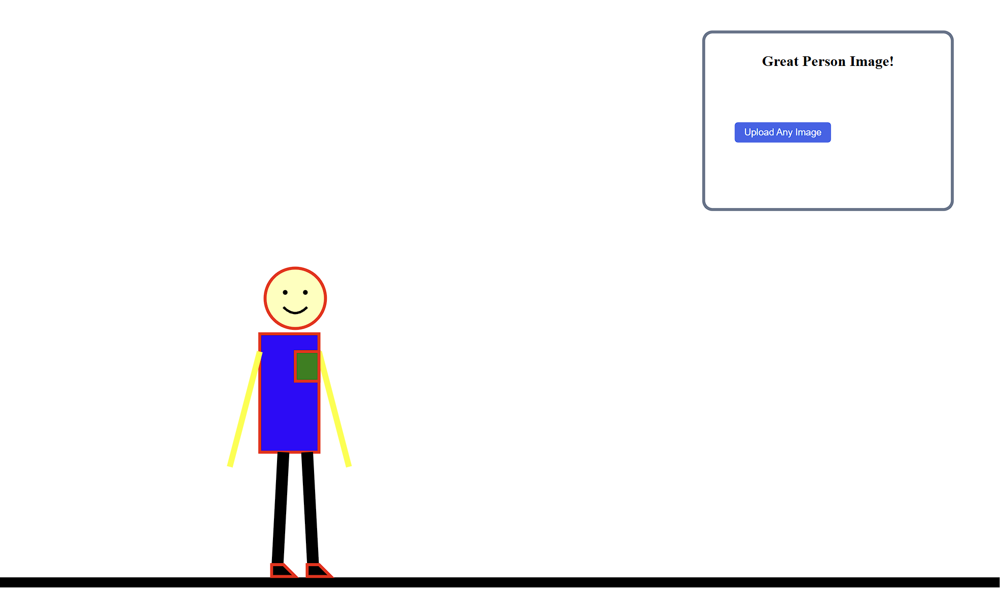
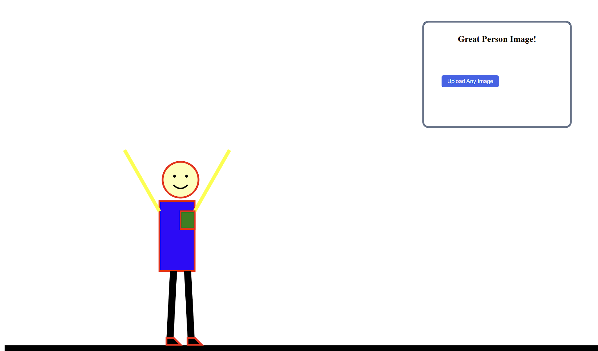
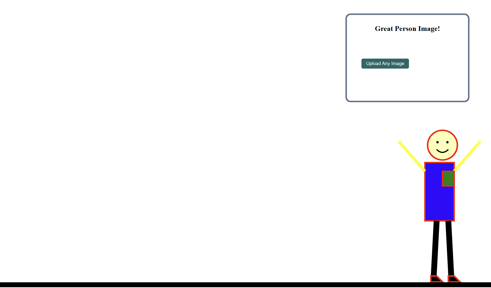

Homework1
link: https://github.com/WPI-SimonTong/a1-ghd3

At the starting position  the person have his arms pointed down, it will then repeat the move that move their arm up  and down to praise the image on the right. There is a button that allows the user to select an image from their computer. The person can also be moved with (A/left arrow) and (D/right arrow) 

The Technical Achievement is the upload image button, it also check if the user uploaded an image, and allow the user to move the person.
The Design Achievement is the figure of person moving his arms.
